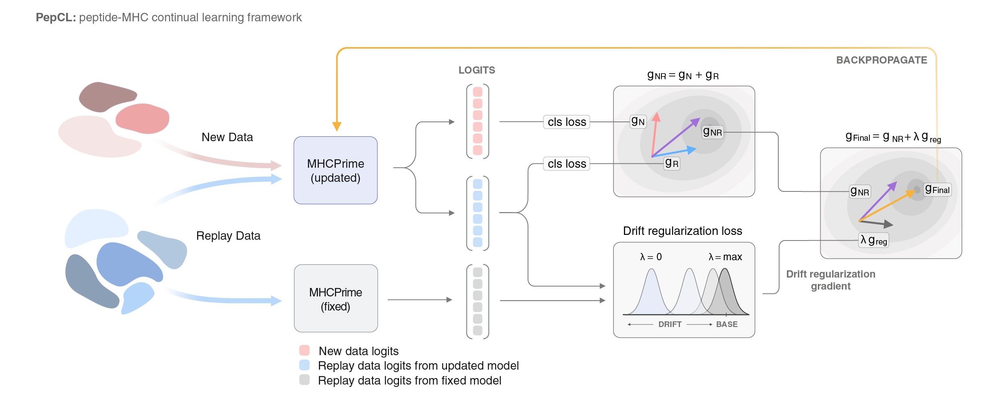

# PepCL

[](https://github.com/ntranoslab/PepCL/actions/workflows/tests.yml) [](https://colab.research.google.com/github/ntranoslab/PepCL/blob/main/notebooks/01_pepcl_quickstart.ipynb)

PepCL is a continual learning framework for adapting peptide–MHC class I prediction models to new datasets while retaining performance on prior mass-spectrometry-derived peptide presentation data.

PepCL builds on [MHCPrime](https://github.com/ntranoslab/MHCPrime), which provides the base peptide–MHC model, tokenizer, preprocessing utilities, and inference functions used throughout the PepCL workflow.



## Overview

PepCL updates a base peptide–MHC model using new task-specific data while optionally replaying prior mass-spectrometry-derived peptide presentation data. This allows users to adapt MHCPrime to new experimental domains while reducing loss of performance on the original presentation task.

The current quickstart demonstrates PepCL adaptation using yeast display data ([Holec et al., 2025](https://www.pnas.org/doi/10.1073/pnas.2514741122)) and matched MHCPrime MS replay data. It includes both the standard PepCL update and the memory-efficient PepCL microbatch backend.

## Installation

We recommend installing PepCL in a clean Conda environment to avoid modifying packages in an existing Python environment.

```bash
conda create -n pepcl_env python=3.9 -y
conda activate pepcl_env
```

Clone the PepCL repository and install it in editable mode:

```bash
git clone https://github.com/ntranoslab/PepCL.git
cd PepCL
python -m pip install -e .
```

The installation automatically installs the pinned MHCPrime dependency specified in `pyproject.toml`.

For development, install the optional development dependencies:

```bash
python -m pip install -e ".[dev]"
```

Verify the installation:

```bash
python -c "import pepcl, mhcprime; print('pepcl', pepcl.__version__); print('mhcprime', mhcprime.__version__)"
```

### Local development note

If you are actively developing PepCL while also using a local editable installation of MHCPrime, you can install PepCL without resolving dependencies again:

```bash
python -m pip install -e . --no-deps
```

This is mainly useful for development environments where MHCPrime is already installed locally. For most users, use:

```bash
python -m pip install -e .
```

## Dependencies

PepCL is implemented in Python and uses PyTorch for model training and inference. The core dependencies are installed automatically from `pyproject.toml`.

Main dependencies include:

* `mhcprime`, installed from the pinned MHCPrime GitHub release/tag
* `torch`
* `numpy`
* `pandas`
* `tqdm`
* `transformers`
* `scikit-learn`
* `matplotlib`

A CUDA-enabled GPU is recommended for running the full quickstart notebook. The notebook can run on CPU for small tests, but training and inference will be substantially slower.

## Hardware requirements

PepCL is GPU-oriented because it updates MHCPrime using new training data and optional MS replay data. CPU execution may be sufficient for installation checks and very small tests, but GPU execution is strongly recommended for the quickstart notebook and for practical PepCL updating.

Recommended hardware:

* Installation and unit tests: CPU or any CUDA-capable GPU.
* Small quickstart runs: CUDA GPU with at least 8 GB GPU memory.
* PepCL microbatch backend: CUDA GPU with at least 8-16 GB GPU memory recommended.
* Standard PepCL updates: modern CUDA GPU with 16 GB or more GPU memory recommended.
* Manuscript-scale experiments: local or server GPUs with larger memory capacity are recommended.

The microbatch backend reduces GPU memory usage by splitting large effective batches into smaller microbatches. This is useful for running PepCL on smaller GPUs, but it does not make full continual-learning updates CPU-oriented.

The Colab notebook is intended as a lightweight demonstration of the PepCL workflow. Free Colab GPU availability and GPU type may vary, so larger runs and manuscript-scale experiments should be performed on a local workstation or server GPU when possible.


## Data

The quickstart notebook uses external PepCL example data that are not stored directly in this GitHub repository. Download the PepCL data bundle from [Google Drive](https://drive.google.com/drive/folders/128SrLjjlG_L_KzFFxBwU_zmqtQyG4yow?usp=sharing).

Place the downloaded data under:

```text
PepCL/
└── pepcl_data/
    ├── ms_train_test_sets/
    │   ├── ms_train_data.csv.gz
    │   └── ms_test_data.csv.gz
    └── holec_train_test_sets/
        ├── holec_train_set.csv.gz
        └── holec_test_set.csv.gz
```

In Google Colab, the quickstart notebook includes a Colab-only download cell that downloads this data folder automatically. Generated outputs, downloaded data, caches, and model checkpoints are intentionally excluded from Git.

## Quickstart notebook

The main example is provided in:

```text
notebooks/01_pepcl_quickstart.ipynb
```

Open the notebook locally after installing PepCL, or launch it in Google Colab using the badge at the top of this README.

The notebook demonstrates:

1. loading the base MHCPrime model,
2. preparing matched MS replay and Holec yeast-display fine-tuning data,
3. running standard fine-tuning without replay,
4. running PepCL with MS replay and drift regularization,
5. optionally running the memory-efficient PepCL microbatch backend,
6. saving updated model weights,
7. scoring held-out MS and Holec test sets with the base and updated models,
8. computing and plotting evaluation metrics.

The notebook is designed so users can run the standard PepCL update and then jump directly to inference, or optionally run the microbatch section for lower-memory training.

## Google Colab

The quickstart notebook can be opened directly in Google Colab using the badge at the top of this README.

In Colab, the notebook:

1. clones the PepCL repository,
2. installs PepCL in editable mode,
3. downloads the external PepCL example data from Google Drive,
4. defines the expected local paths under `/content/PepCL`,
5. runs the same training and inference workflow as the local notebook.

The Colab workflow expects the repository to be public and the pinned MHCPrime dependency to be accessible from GitHub.

## Repository layout

```text
PepCL/
├── README.md
├── pyproject.toml
├── LICENSE
├── CITATION.cff
├── assets/
│   └── pepcl_schema.png
├── notebooks/
│   └── 01_pepcl_quickstart.ipynb
├── src/
│   └── pepcl/
│       ├── __init__.py
│       ├── pepcl.py
│       ├── preprocessing.py
│       ├── metrics.py
│       ├── plotting.py
│       ├── utils.py
│       ├── assets.py
│       └── version.py
└── tests/
```

The following directories are generated or downloaded locally and are not tracked by Git:

```text
pepcl_data/
pepcl_outputs/
model_checkpoints/
outputs/
```

## Core package modules

PepCL currently exposes the following main modules:

* `pepcl.pepcl`: standard PepCL and PepCL microbatch training classes.
* `pepcl.preprocessing`: helper utilities for preparing matched MS replay and new-domain training data.
* `pepcl.metrics`: metric computation functions used for evaluation.
* `pepcl.plotting`: plotting functions used for notebook visualization.
* `pepcl.utils`: utility functions for reproducibility, device selection, memory cleanup, and file handling.
* `pepcl.assets`: path helpers for external data and output directories.

## Testing

Run the test suite with:

```bash
python -m pytest
```

The GitHub Actions workflow runs the same tests automatically on push and pull request.

## Scripts

Command-line scripts are planned but are not part of the current public quickstart workflow yet. For now, use the notebook workflow in:

```text
notebooks/01_pepcl_quickstart.ipynb
```

## Model checkpoints and outputs

PepCL does not store updated model checkpoints in Git. The quickstart notebook writes generated checkpoints and outputs to local folders such as:

```text
model_checkpoints/
pepcl_outputs/
```

These folders are excluded from version control.

## License

This project is released under the MIT License. See the `LICENSE` file for details.

## Citation

Citation to be added.

